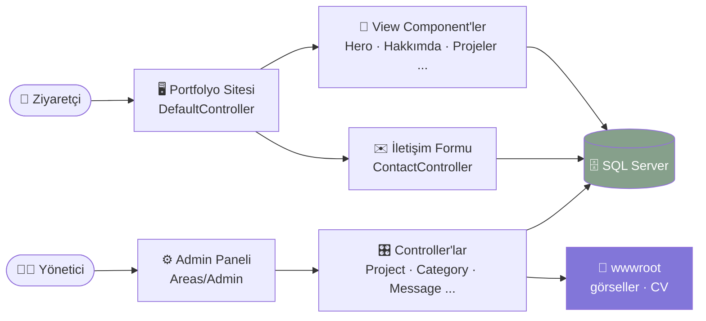
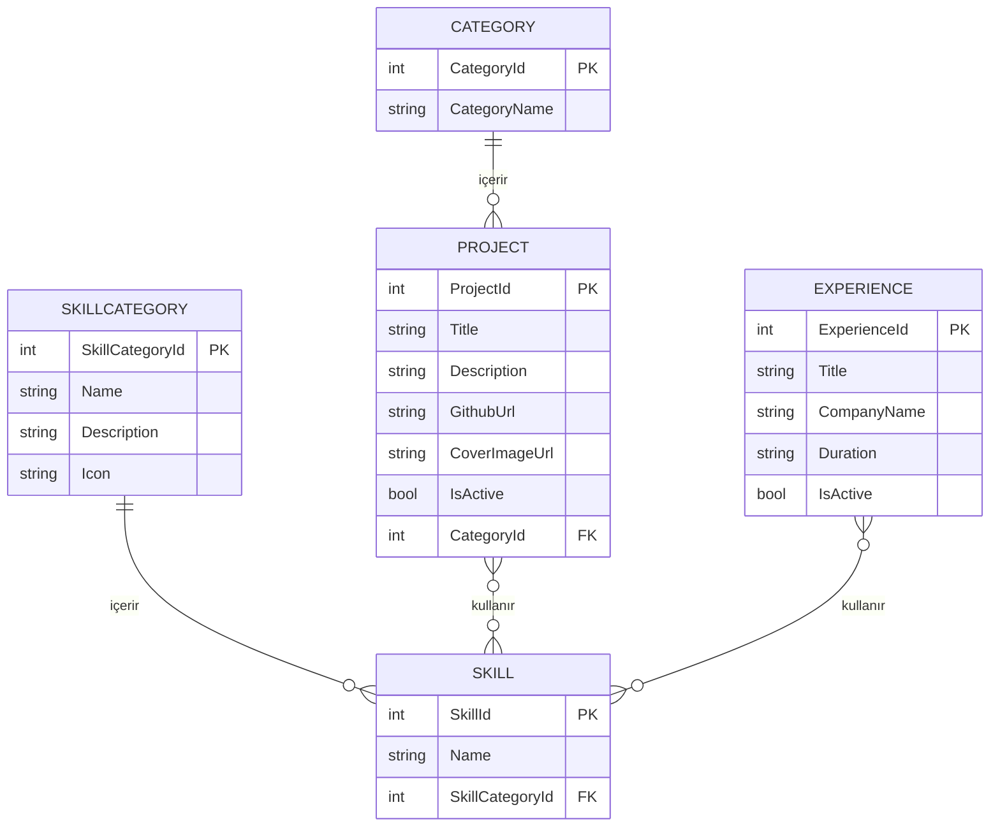

<div align="center">

# 🌐 MYAcademy Portfolio

### Yönetim panelinden tamamen yönetilebilen, veritabanı destekli kişisel portfolyo sitesi

<p>
  
  
  
</p>
<p>
  
  
  
  
</p>

**M&Y Yazılım Eğitim Akademi**  1. Proje

[Özellikler](#-özellikler) •
[Mimari](#-mimari) •
[Veritabanı](#-veritabanı-şeması) •
[Teknikler](#-uygulanan-teknikler) •
[Kurulum](#-kurulum) •
[Ekran Görüntüleri](#-ekran-görüntüleri)

</div>

---

## 💡 Proje Hakkında

Bu proje, statik bir portfolyo tasarımını **veritabanı destekli, yönetilebilir ve bütünleşik** bir web uygulamasına dönüştürür.

Sitede gördüğünüz **her şey** (isim, tanıtım yazısı, profil fotoğrafı, eğitimler, deneyimler, yetenekler, projeler, sosyal medya bağlantıları ve indirilebilir CV) **admin panelinden** yönetilir. Panelde yapılan her değişiklik sitede **anında** görünür; kodda tek satır değiştirmeye gerek kalmaz.

<table>
<tr>
<td width="50%" valign="top">

### 🖥️ Portfolyo Sitesi
Ziyaretçilerin gördüğü, tek sayfalık modern portfolyo.

`https://localhost:xxxx/`

</td>
<td width="50%" valign="top">

### ⚙️ Yönetim Paneli
İçeriklerin eklendiği, düzenlendiği ve istatistiklerin izlendiği panel.

`https://localhost:xxxx/Admin`

</td>
</tr>
</table>

---

## ✨ Özellikler

### 🎯 Öne Çıkanlar

| | Özellik | Açıklama |
|:---:|---|---|
| 📊 | **Canlı Dashboard** | 7 istatistik kartı, son mesajlar, son projeler ve kategori bazında proje grafiği. Hepsi EF Core sorgularıyla anlık hesaplanır |
| 🏷️ | **Etiketli Yetenek Formu** | Yetenekler etiket olarak eklenir; hazır öneri listesi sunulur, veritabanında olanlar önerilmez |
| 🖼️ | **Görsel Yükleme** | Proje kapakları ve profil fotoğrafı için tür/boyut kontrollü, benzersiz isimli güvenli yükleme |
| 📄 | **Akıllı CV Yükleme** | Yalnızca PDF kabul edilir. Uzantının yanında dosya imzası (`%PDF`) da kontrol edilir |
| 🛡️ | **Korumalı Silme** | İçinde proje bulunan kategori silinemez; yanlışlıkla veri kaybı engellenir |
| 🔗 | **Dinamik Sosyal Medya** | Tek bir bileşen; ana sayfa, iletişim ve footer'da aynı anda güncellenir |
| 👁️ | **Aktif / Pasif** | Pasif yapılan eğitim, deneyim ve projeler sitede otomatik gizlenir |

<details>
<summary><b>🖥️ Portfolyo Sitesi: tüm özellikler</b></summary>
<br>

- **Ana sayfa:** Ad, karşılama rozeti, tanıtım yazısı ve profil fotoğrafı veritabanından gelir
- **Hakkımda, Eğitim, Deneyim, Yetenekler, Projeler** bölümleri tamamen dinamik
- **Tarih sıralaması:** Eğitim ve deneyimler en güncelden eskiye sıralanır, "Halen" devam edenler en üstte
- **Proje filtresi:** Projeler kategori butonlarıyla filtrelenir
- **Yetenekler:** Kategoriler halinde kartlarda gösterilir
- **İletişim formu:** Ad, e-posta, konu ve mesaj doğrulanarak veritabanına kaydedilir
- **CV İndir:** Admin'den yüklenen güncel CV'yi düzgün bir dosya adıyla indirir; CV yoksa buton gizlenir
- **Menü:** Tüm bağlantılar ilgili bölümlere kaydırır

</details>

<details>
<summary><b>📊 Dashboard</b></summary>
<br>

- **İstatistik kartları:** Toplam proje · Aktif proje · Yetenek · Deneyim · Eğitim · Toplam mesaj · Okunmamış mesaj
- **Son 5 mesaj:** Gönderen, konu, tarih ve okundu durumu. Tıklanınca mesajın detayı otomatik açılır
- **Son 3 proje:** Proje adı, kategori ve aktif/pasif durumu, düzenleme bağlantısıyla
- **Kategori özeti:** Kategori bazında proje sayıları (`GroupBy`) ve oransal çubuk grafik
- **Hızlı işlemler:** Yeni proje ekle · Mesajları görüntüle · Portfolyoyu aç
- Tüm veriler tek bir **`DashboardViewModel`** ile taşınır, sabit sayı kullanılmaz

</details>

<details>
<summary><b>📁 Projeler ve Kategoriler</b></summary>
<br>

**Projeler**
- Tam CRUD: listele, ekle, güncelle, sil
- Veritabanından gelen **kategori dropdown'u** (`SelectList` / `asp-items`)
- **Çoklu yetenek seçimi:** Kullanılan teknolojiler aranabilir çipler halinde seçilir (çoka-çok ilişki)
- **Kapak görseli:** Önizlemeli yükleme; güncellemede eski dosya silinir, görsel değiştirilmezse mevcut olan korunur
- Liste sayfasında **arama**, **kategori** ve **durum** filtresi, renkli aktif/pasif etiketi

**Proje Kategorileri**
- Tam CRUD, her kategorinin yanında proje sayısı
- Aynı isimde iki kategori eklenemez
- İçinde proje olan kategori **silinemez** (hem arayüzde hem sunucuda kontrol edilir)

</details>

<details>
<summary><b>💡 Yetenek Kategorileri</b></summary>
<br>

- Tam CRUD; ikon seçimi ve canlı önizleme
- Kategori eklerken yetenekler **etiket** olarak yazılır (Enter, virgül veya "Ekle" butonu)
- `datalist` ile **öneri listesi**; tekrar eden ve boş değerler otomatik temizlenir
- Güncellemede **fark mantığı:** Sadece kaldırılan yetenekler silinir, sadece yeniler eklenir. Değişmeyen yeteneklerin proje bağlantıları korunur

</details>

<details>
<summary><b>✉️ Mesajlar</b></summary>
<br>

- **Okundu / okunmadı** sekmeleri ve sayaçları
- Gönderene, e-postaya veya konuya göre **arama**; tarihe göre **sıralama**
- Mesaj detayı **Bootstrap Modal** ile açılır ve otomatik olarak okundu işaretlenir
- Silme öncesi **SweetAlert2** onay penceresi
- Gelen mesajın orijinal içeriği düzenlenemez

</details>

<details>
<summary><b>👤 Hakkımda · ⚙️ Ayarlar · 🔗 Sosyal Medya · 🎓 Eğitim · 💼 Deneyim</b></summary>
<br>

- **Hakkımda:** Tek formdan güncellenir ("varsa güncelle, yoksa oluştur" mantığı), karakter sayaçlı açıklama alanı
- **Ayarlar:** Ana sayfa yazıları, profil fotoğrafı ve CV tek ekranda; dosyalar önizlemeli
- **Sosyal Medya:** GitHub, LinkedIn, Instagram, X, YouTube gibi platformlar için hızlı seçim; `https://` ve `mailto:` bağlantı kontrolü
- **Eğitim / Deneyim:** Aktif/pasif durumu renkli etiketle, kayıtlar tarihe göre sıralı

</details>

---

## 🏗️ Mimari



**Akış:** Yönetici panelden içerik ekler → veriler **EF Core** ile SQL Server'a kaydedilir → site bölümlerindeki **View Component**'ler bu verileri okuyup sayfayı oluşturur.

---

## 🗄️ Veritabanı Şeması



| İlişki | Tür | Açıklama |
|---|---|---|
| `Category` → `Project` | **Bire-çok** | Her projenin bir kategorisi vardır (FK + Navigation Property) |
| `SkillCategory` → `Skill` | **Bire-çok** | Her yetenek bir kategoriye aittir |
| `Project` ↔ `Skill` | **Çoka-çok** | Bir projede birçok yetenek, bir yetenek birçok projede |
| `Experience` ↔ `Skill` | **Çoka-çok** | EF Core ara tabloyu otomatik oluşturur |

> Diğer tablolar: `About`, `HeroSection` (ana sayfa + CV yolu), `Contact`, `SocialMedia`, `Message`, `Education`

---

## 🧠 Uygulanan Teknikler

<table>
<tr>
<td width="50%" valign="top">

#### 🗃️ Veri Katmanı
- **Code First** yaklaşımı ve **Migrations**
- Mevcut veriyi koruyan *data migration* (`migrationBuilder.Sql`)
- Bire-çok ve çoka-çok ilişkiler
- LINQ: `Include` · `Where` · `Select` · `Count` · `Any` · `OrderByDescending` · `Take` · `GroupBy` · `Distinct`

#### ✅ Doğrulama
- **Data Annotations:** `Required` · `StringLength` · `Range` · `EmailAddress` · `Url` · `ValidateNever`
- `ModelState.IsValid` ile sunucu taraflı kontrol
- `AddModelError` ile özel kurallar (aynı isim, dosya türü…)
- Türkçe hata mesajları

</td>
<td width="50%" valign="top">

#### 🧩 Yapı
- **ViewModel'ler:** `DashboardViewModel` · `ProjectFormViewModel` · `SkillCategoryFormViewModel`
- **View Component'ler:**
  - Site: Navbar · Hero · Hakkımda · Eğitim · Deneyim · Yetenek · Proje · İletişim · Footer · Sosyal Medya
  - Admin: Head · Style · Sidebar · Script
- Tek bileşenin birden çok yerde kullanımı (Sosyal Medya)

#### 🔒 Dosya & Güvenlik
- `IFormFile` + `IWebHostEnvironment`
- Tür, boyut ve **dosya imzası** kontrolü
- `Guid` ile benzersiz dosya adları
- Sadece izinli klasörlerde silme
- Tüm formlarda `ValidateAntiForgeryToken`

</td>
</tr>
</table>

#### 🔔 Kullanıcı Deneyimi
`TempData` + **SweetAlert2** ile işlem bildirimleri · **Bootstrap Modal** ile detay görünümü · arama ve filtreler · görsel önizleme · boş liste mesajları · responsive tasarım

---

## 📂 Proje Yapısı

```
MYAcademy_Portfolio/
│
├── 📁 Areas/Admin/
│   ├── Controllers/       → Dashboard · Project · Category · SkillCategory · Message
│   │                        About · Education · Experience · SocialMedia · Setting
│   ├── Models/            → DashboardViewModel · ProjectFormViewModel · SkillCategoryFormViewModel
│   ├── ViewComponents/    → Admin layout bileşenleri
│   └── Views/             → Admin sayfaları
│
├── 📁 Controllers/        → DefaultController (site) · ContactController (iletişim formu)
├── 📁 Context/            → PortfolioContext (DbContext)
├── 📁 Entities/           → Veritabanı tabloları
├── 📁 Helpers/            → DurationHelper ("2021 - Halen" → sıralama için yıl çıkarma)
├── 📁 Migrations/         → EF Core migration geçmişi
├── 📁 ViewComponents/     → Site bileşenleri
├── 📁 Views/              → Site sayfası ve bileşen görünümleri
└── 📁 wwwroot/            → CSS, JS, yüklenen görseller ve CV
```

---

## 🙏 Teşekkür

Bu projenin ortaya çıkmasında emeği olan, **ASP.NET Core MVC** ve **Entity Framework Core** temellerini öğreten ve eğitim boyunca desteğini esirgemeyen değerli hocam **Murat Yücedağ**'a ve **M&Y Yazılım Eğitim Akademi** ailesine içtenlikle teşekkür ederim. 💜

---

<div align="center">

## 👩‍💻 Geliştirici

**Sara Ebrar Acar**
Bilgisayar Mühendisi · Full Stack Developer

<a href="https://github.com/sebraracr">
  
</a>

<br><br>

⭐ Projeyi beğendiyseniz yıldız vermeyi unutmayın!

</div>


